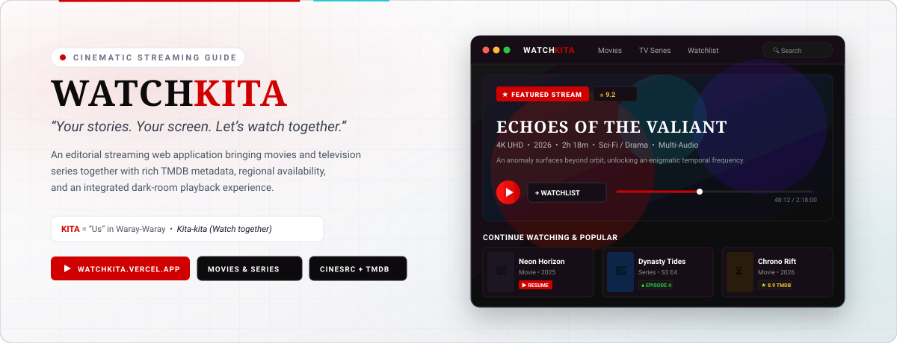
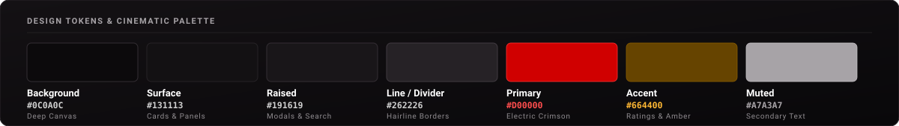

  <picture>
    <source media="(prefers-color-scheme: dark)" srcset="docs/readme-banner-dark.svg">
    <source media="(prefers-color-scheme: light)" srcset="docs/readme-banner-light.svg">
    
  </picture>

  

    
    
    
  

  <a href="https://watchkita.vercel.app/"><strong>watchkita.vercel.app</strong></a> 
  <strong>WatchKITA</strong> · Cinematic streaming and discovery guide for movies and TV series.

WatchKITA is an editorial streaming web application and title discovery guide for film and
television lovers. Built around a theater-dark aesthetic, it provides a distraction-free
environment to discover trending titles, explore multi-genre catalogs, check legal regional
streaming availability, and launch instant in-app playback—bringing movie and television
entertainment together into one cohesive interface. In Waray-Waray, **KITA** carries the intended
wordplay of both **"watch"** and **"us,"** while **KITA-KITA** expresses the brand's invitation:
*"let's watch."* Combining these meanings, **WatchKITA** communicates **"Let's watch together."**

  <a href="#what-it-does">What it does</a> ·
  <a href="#design">Design</a> ·
  <a href="#stack">Stack</a>

**At a glance**

- **Live app:** [watchkita.vercel.app](https://watchkita.vercel.app/).
- **Purpose:** discover what's new, check regional streaming availability, and stream movies and TV shows in a single unified interface.
- **Catalog:** movies and television series across genres, release years, and regions, powered by TMDB.
- **Streaming:** in-app video playback via the CineSrc player engine with episode selection.
- **Watchlist:** save-for-later collection with local persistence and optional Supabase device sync.
- **Design:** obsidian background (`#0C0A0C`), velvet surfaces (`#131113`), and electric crimson accents (`#D00000`).

## The story behind the name

WatchKITA brings together the idea of watching and togetherness. In Waray-Waray, **KITA**
carries the intended wordplay of **"watch"** and **"us,"** while **KITA-KITA** expresses the
brand's invitation: **"Let's watch."** WatchKITA is built around the idea of enjoying movies
and television stories together.

WatchKITA brings title discovery and viewing into one unified experience, allowing users to
explore trending titles, browse genres, check regional streaming availability, and launch
playback within a cinematic interface.

---

## What it does

**Home & Hero (`/`)**

- Rotating featured hero banner showcasing trending cinematic releases with backdrop imagery, real-time ratings, synopsis, runtime, and a direct "Watch Now" action.
- Curated discovery rails: trending tonight, popular titles, recent releases, and genre selections.
- Instant "+ Watchlist" toggle directly on the hero banner.

**Catalog browser (`/movies`, `/tv-shows`, `/discover`)**

- Shared exploration engine across movies and television series.
- Multi-genre selection chips with instant dismiss.
- Release year range filters (start year to end year).
- Sort options: Popularity, Vote Average / Rating, Release Date, and Title Alphabetical.
- Region switching to localize catalog availability.
- Load-more pagination with state caching for seamless back-navigation.

**Search (`/search`, `/tmdb-search`)**

- Full-screen search overlay with debounced queries and instant dropdown suggestions.
- Keyboard navigation shortcuts (`/` to open, `Escape` to close).
- Recent search queries stored locally in the browser for rapid re-searching.
- Dedicated full results pages for catalog titles and TMDB queries.

**Title details (`/title/:id`)**

- High-resolution poster and widescreen backdrop artwork.
- Synopsis, release year, runtime, age ratings, and TMDB audience scores.
- Embedded official YouTube trailer viewer.
- Cast & crew roster with actor headshots and character roles.
- Comprehensive TV season and episode breakdown with episode air dates, runtimes, and overviews.
- Regional watch provider availability grouped by Subscription, Free, Digital Rental, and Purchase.
- "Similar Titles" recommendation rail.

**In-app playback (`/watch/movie/:tmdbId`, `/watch/tv/:tmdbId`)**

- Direct in-browser video playback for movies and television series via the embedded CineSrc engine.
- Interactive episode selector with season tabs and individual episode synopses.
- Autoplay, autonext episode chaining, and theater-mode framing.
- Quick navigation return to title details or catalog browsing.

**Personal Watchlist (`/watchlist`)**

- One-tap save action on any title card, hero banner, or detail page.
- Toggle between responsive Grid View and dense List View.
- Filter saved items by Movies vs. TV Series.
- Local-first persistence in browser `localStorage` with optional remote device synchronization via Supabase.
- Per-item removal and confirmed "Clear All" modal to prevent accidental data loss.

---

## Design

  

| Token | Value | Role |
| --- | --- | --- |
| Background | `#0C0A0C` | Deep obsidian canvas for late-night viewing with minimal eye fatigue |
| Surface | `#131113` | Velvet charcoal for cards, panels, and content containers |
| Raised | `#191619` | Elevated surfaces, modals, dropdowns, and search overlay |
| Line | `#262226` | Hairline dividers, card outlines, and structural boundaries |
| Primary | `#D00000` | Electric crimson for hero buttons, active tabs, and marquee accents |
| Accent | `#664400` | Deep amber for star ratings, badges, and scrollbar highlights |
| Muted | `#A7A3A7` | Soft silver for secondary metadata, descriptions, and timestamps |

WatchKITA is built for late-night streaming and movie marathons. Its visual language avoids blinding
white backgrounds in favor of an obsidian and velvet palette reminiscent of vintage cinema auditoriums
and red velvet curtains. Fonts pair Inter for crisp interface legibility with Playfair Display for
editorial headings. Motion uses Framer Motion easing (`cubic-bezier(0.22, 1, 0.36, 1)`) with full
support for `prefers-reduced-motion`. Cards use 8px–12px radii, controls use 6px, and letter spacing
features an editorial wide tracking on eyebrows.

---

## Stack

| Layer | Technology |
| --- | --- |
| Frontend | React 18, Vite 5, TypeScript 5, React Router 6, TanStack Query |
| Styling | Tailwind CSS 3, Framer Motion, Lucide React |

---

  <strong>WatchKITA</strong> · Cinematic Movie &amp; TV Streaming Experience · <em>Let's watch, together</em> 
  <a href="https://watchkita.vercel.app/">watchkita.vercel.app</a>

